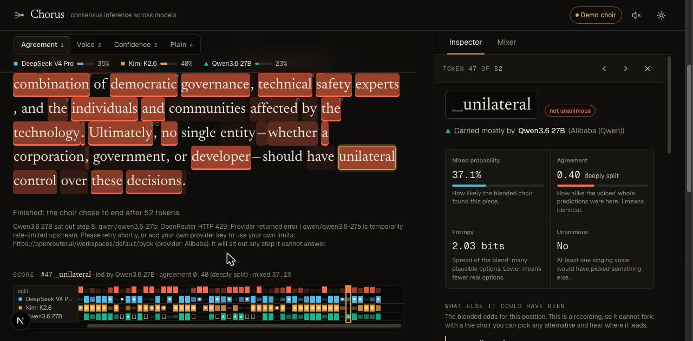
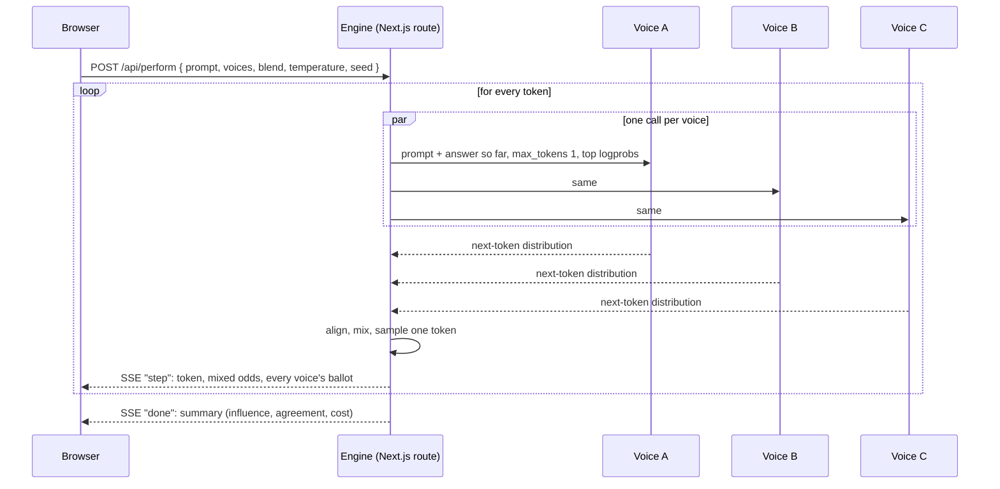

# Chorus — consensus inference across models

**Several LLMs write one answer together, one token at a time, and you can click any token to see how each model voted.**

**[▶ Try the live demo](https://asmar-io.github.io/llm-token-consensus/)** (no install, no key: replays real recorded performances)



A normal LLM answer comes from one model, so one lab's training data and rules decide every word. Chorus asks several models from different labs the same question at every step: *given the answer so far, what comes next, and how sure are you?* It blends their probability distributions, samples one token from the blend, appends it, and asks again.

The result is a text no single model wrote, plus a complete record of every vote behind it.

- **Every token is inspectable**: who carried it, how far the voices agreed, what each would have said alone, and what else it could have been.
- **Fork from any alternative** and hear how one different word changes everything after it.
- **Works with no API key**: the demo replays real performances recorded from the live choir.

> Status: a working research prototype. The live path was verified against real models on 2026-11-12. See [Limitations](#limitations) before relying on it.

## Contents

- [How it works](#how-it-works)
- [Quick start](#quick-start)
- [The interface](#the-interface)
- [The engine](#the-engine)
- [Getting real models to continue a sentence](#getting-real-models-to-continue-a-sentence)
- [Models](#models)
- [Demo mode](#demo-mode)
- [API](#api)
- [Project layout](#project-layout)
- [Testing and verification](#testing-and-verification)
- [Cost and speed](#cost-and-speed)
- [Limitations](#limitations)
- [FAQ](#faq)

## How it works



One step, in order:

1. **Poll.** Every voice in the choir gets the prompt and the text written so far, and returns its top candidates for the next token with probabilities.
2. **Align.** Candidates are matched across voices by exact string.
3. **Mix.** The per-voice distributions are combined into one, weighted by each voice's gain.
4. **Sample.** One token is drawn from the mix with a seeded generator, so a performance can be replayed exactly.
5. **Record.** The step is streamed to the browser with every voice's ballot attached.

The loop ends when the mix picks the end-of-sequence token, the token limit is reached, or the client disconnects.

## Quick start

Requires Node.js 20 or newer.

```bash
git clone https://github.com/asmar-io/llm-token-consensus.git
cd llm-token-consensus
npm install
npm run dev          # http://localhost:3000
```

With no configuration this starts in **demo mode** and replays recorded live performances.

For a **live choir**, add an [OpenRouter](https://openrouter.ai) key:

```bash
cp .env.example .env.local
# then set OPENROUTER_API_KEY=... in .env.local
```

| Variable | Purpose |
|---|---|
| `OPENROUTER_API_KEY` | Turns on live mode. Read server side only; never sent to the browser. |
| `CHORUS_MODELS` | Optional. Comma-separated OpenRouter slugs, each optionally pinned as `slug@providerTag`, to replace the built-in list. Unverified models may not continue text correctly. |

Before trusting a live setup, run the smoke test. It sends real requests (well under one US cent in total) and checks that every model continues a partial answer and knows when to stop:

```bash
OPENROUTER_API_KEY=... node scripts/live-smoke.mjs
```

## The interface

| Surface | What it shows |
|---|---|
| **Manuscript** | The answer, streaming token by token. Every token is a button. |
| **Lenses** | Tint the text by Agreement (where the voices split), Voice (who carried each token), Confidence (mixed probability), or Plain. |
| **Inspector** | For the selected token: mixed probability, agreement, entropy, the ranked alternatives, and one row per voice with its share, the probability it gave, its rank, its own top choices, latency and cost. |
| **Fork** | Pick any alternative in the inspector to start a new take from that point with that token forced. Takes are kept side by side. |
| **Mixer** | Choose which models sing (two or more), set each voice's gain, mute (still listening, no influence) or solo it, and set blend mode, temperature, seed and token limit. |
| **Score** | One lane per voice and one column per token, showing how strongly each voice backed what was chosen. |
| **Finale** | Influence share per voice, tokens led, mean agreement, time, cost, and the most contested tokens as jump links. |

Also: replay with a scrubber, copy text, export a take as JSON, keyboard navigation (`←` `→` between tokens, `F` to fork, `1`–`4` for lenses, `/` to focus the prompt), an optional sound per token, and light and dark themes.

## The engine

All engine code is in [`src/engine`](src/engine). The core is an async generator, `perform(request, voices, signal)`, that yields the same events the API streams, so it is tested without HTTP.

### Alignment: exact string match

Voices have different tokenizers, so they cut the same text differently (`" dec"` versus `" decentral"`). The candidate set for a step is the union of the strings the singing voices proposed, and a voice's probability for a candidate is the probability it gave *that exact string*, renormalised over the set.

Sharing probability between tokens of different lengths was tried twice and removed, because both versions corrupted text against real models:

| Attempt | What went wrong (live run, 2026-11-12) |
|---|---|
| Credit a shorter candidate from longer tokens | The fragment `'` collected the mass of every voice that wanted `'t`, was sampled, and left `shouldn' be`. |
| Credit a longer candidate from shorter tokens | One voice's rare `" cans"` received 4/5 of every other voice's `" can"`, giving `cans undermine trusts`. |

A top-k list does not say how likely `s` is after `" can"`, so any ratio is invented probability. With exact matching, voices that cut a word differently split their vote; whichever cut wins, the next step completes the word. The only cost is that such a step reads as less agreed than it was.

### Mixing

With normalised weights `w` over the voices that are singing and answered:

| Mode | Formula | Behaviour |
|---|---|---|
| **Mixture** | `M(c) = Σ w_m · P_m(c)` | Arithmetic mean. One voice can carry a token it strongly wants. Default. |
| **Consensus** | `M(c) ∝ exp(Σ w_m · ln max(P_m(c), floor_m))` | Geometric mean. A token any voice finds very unlikely is nearly ruled out. |

`floor_m` is half of that voice's smallest listed probability, clamped to `[1e-4, 1e-2]`, so a voice that did not list a token punishes it hard without zeroing it.

Muted voices (weight 0) are still polled and shown, but their candidates do not enter the mix.

### Sampling

Temperature is applied to the mixed distribution (`p^(1/T)`, renormalised); `0` means take the top token. The generator is `mulberry32` seeded from the request seed and the absolute step index, so the same request replays identically and a fork at step *k* is deterministic too.

### What each step reports

| Field | Definition |
|---|---|
| `p` | Mixed probability of the chosen token. |
| `share` (per voice) | The voice's part of the chosen token's support. Mixture: `w_m·P_m / M`. Consensus: weighted log-lift above the floor. Sums to 1. |
| `lead` | The voice with the largest share. |
| `agreement` | `1 − JSD(voices) / log2(n)`: 1 when the voices' distributions are identical, 0 when maximally split. |
| `unanimous` | Every singing voice's own top token equals the chosen one. |
| `entropy` | Entropy of the mixed distribution, in bits. |

### Failure handling

A voice that errors or exceeds its timeout sits that step out; the others carry on and the UI shows a quiet notice. If every singing voice fails on a step, the run ends with an error. Client disconnect aborts all in-flight calls.

## Getting real models to continue a sentence

This was the hard part, and it shapes which models can take part. A voice must do two things most hosted models do not:

1. **Continue a half-written answer** instead of starting a fresh reply.
2. **Return token probabilities** (`logprobs` with `top_logprobs`).

What was measured on OpenRouter on 2026-11-12, across 456 model and provider pairs (274 of which returned logprobs):

- **Assistant prefill is not continued on almost any provider.** Given the answer so far `one two three four`, nearly every provider starts over (`one`, `It`) instead of producing ` five`. That includes Llama 3.3 70B, Gemma 3/4, Mistral Nemo/Small and GPT-4o.
- **The text completions endpoint is no way out.** It wraps the prompt in the chat template on every provider tested.
- **vLLM pass-through flags** (`continue_final_message`, `add_generation_prompt`) are not forwarded.
- **What does continue:** DeepSeek V4 on Novita, Kimi K2.6 on Moonshot's own API with `partial: true`, and Qwen3.x on Alibaba's own API with `partial: true`.

The adapter in [`src/engine/voices/openrouter.ts`](src/engine/voices/openrouter.ts) then handles what real providers do:

| Problem | Handling |
|---|---|
| **Trailing whitespace.** A prefill ending in a space confuses some providers and is trimmed by others. | Never send it. Hold the whitespace back and keep only candidates that start with it. |
| **Mid-word text.** A prefill ending inside a word is tokenised unnaturally (`Par` → `ís`, 91%). | Token healing: two parallel requests, one with the full text and one with the last word held back. The second re-picks the word; its mass on extensions gives the completion and its mass on the exact word scales the first. |
| **Healing noise.** If the voice would not have written the word the choir chose, the healed ratios are noise. | Trust the healed view in proportion to how much of the voice's probability agrees with the chosen word, and fall back to the plain continuation for the rest. |
| **Restarts.** One provider ignored the prefill on 4 of 50 identical requests and answered from scratch. | That model is pinned to a provider that continued on 50 of 50. A guard also makes any voice sit out a step when its top candidate is the answer's own first token glued onto a word. |
| **End of answer.** When stopping is the top choice, providers return an empty completion with no probability. | Mapped to the end token. Its probability is then assumed to be 1, not measured. |
| **Split characters.** One token can be part of a multi-byte character. | Invalid candidates are dropped; if the best candidate is partial, a short follow-up request completes the character. |
| **Dropped logprobs.** Providers occasionally return a token without them. | Retry once, otherwise the voice sits out the step. |

Every provider is pinned (`provider.order`, `allow_fallbacks: false`, `require_parameters: true`), because the same model behaves differently on different hosts.

## Models

All six passed the live checks on 2026-11-12. The first three are selected by default; any two or more can be chosen in the UI.

| Model | Lab | Provider | Price per M tokens (in / out) |
|---|---|---|---|
| `deepseek/deepseek-v4-pro-0813` | DeepSeek | Novita | $0.66 / $1.98 |
| `moonshotai/kimi-k2.6` | Moonshot AI | Moonshot AI | $0.95 / $4.00 |
| `qwen/qwen3.6-27b` | Alibaba | Alibaba | $0.45 / $2.70 |
| `qwen/qwen3.5-397b-a17b` | Alibaba | Alibaba | $0.39 / $2.34 |
| `deepseek/deepseek-v4-flash-0731` | DeepSeek | Novita | $0.308 / $0.924 |
| `qwen/qwen3.8-flash` | Alibaba | Alibaba | $0.15 / $0.47 |

Every verified model comes from a Chinese lab. No US or European open-weight model on OpenRouter passed both checks on that date. This is a property of how models are hosted, not of the method: any model with raw access to next-token probabilities can be a voice by implementing the small [`Voice`](src/engine/voice.ts) interface.

To add a model, add an entry with its route to [`catalog.ts`](src/engine/voices/catalog.ts) and run the smoke test against it.

## Demo mode

The hosted demo at **https://asmar-io.github.io/llm-token-consensus/** is a static build published to GitHub Pages by [`.github/workflows/pages.yml`](.github/workflows/pages.yml) on every push to `main`. Pages has no server, so that build drops the API routes and replays the recordings in the browser (`NEXT_PUBLIC_STATIC=1`).


Without a key, the app replays **recorded live performances**: the exact event streams produced by real model calls, stored in [`src/engine/demo/recordings`](src/engine/demo/recordings). Every probability, ballot, latency and cost shown is what happened in that run. Nothing is simulated.

A recording cannot answer a new prompt or fork, and the UI says so. To capture new recordings with a live server running:

```bash
node scripts/record-demo.mjs        # all prompts
node scripts/record-demo.mjs 2 5    # only prompts 2 and 5
```

## API

### `GET /api/choir`

Returns the mode (`live` or `demo`), the voices on offer, which are selected by default, default settings and sample prompts.

### `POST /api/perform`

Body:

```jsonc
{
  "prompt": "Is it ever right to break a promise?",
  "voices": [                     // two or more; weight 0 = muted but listening
    { "id": "deepseek/deepseek-v4-pro-0813", "weight": 1 },
    { "id": "moonshotai/kimi-k2.6", "weight": 1 }
  ],
  "blend": "mixture",             // or "consensus"
  "temperature": 0.7,             // 0..1.5, applied to the mixed distribution
  "seed": 42,
  "maxTokens": 120,               // up to 400
  "prefix": ["Yes", ","],         // optional: fork, tokens to keep
  "forcedNext": " but"            // optional: fork, token to force next
}
```

Response: `text/event-stream`. Each event is `data: <json>` followed by a blank line.

| Event | Payload |
|---|---|
| `start` | Run id, mode, the voices taking part, the request. |
| `step` | One token with its mixed probability, ranked alternatives, every voice's ballot, lead, agreement, entropy and timing. |
| `error` | A message. `fatal: false` means a voice sat out a step; `fatal: true` ends the stream. |
| `done` | Reason (`eos`, `max_tokens`, `aborted`) and a summary: tokens, time, cost, influence per voice, tokens led, mean agreement, most contested steps. |

The full types are in [`src/lib/protocol.ts`](src/lib/protocol.ts).

## Project layout

```
src/
  lib/protocol.ts            wire contract shared by server and client
  engine/
    voice.ts                 the Voice interface (one model = one voice)
    align.ts                 cross-tokenizer alignment
    mix.ts                   mixture / consensus, shares, agreement, entropy
    sample.ts                seeded sampling with temperature
    perform.ts               the generation loop, request validation, summary
    registry.ts              live or demo, which voices are on offer
    voices/
      catalog.ts             verified models and their provider routes
      openrouter.ts          live adapter: prefill, healing, EOS, retries
    demo/
      recorded.ts            replay of recorded live performances
      recordings/*.json      the recordings
  app/api/
    choir/route.ts           GET  /api/choir
    perform/route.ts         POST /api/perform (SSE)
  components/                the interface (manuscript, inspector, mixer, score, finale, FAQ)
  lib/client/                SSE client, store, run control, audio, formatting
scripts/
  live-smoke.mjs             verifies each model against the real API
  record-demo.mjs            records live performances for the demo
```

Stack: Next.js 16 (App Router), React 19, TypeScript, Tailwind CSS 4, Zustand, Motion, Vitest.

## Testing and verification

```bash
npm test             # unit and integration tests (Vitest)
npm run typecheck
npm run lint
```

The tests cover alignment, both blend modes, weights and muted voices, sampling determinism, step invariants (shares sum to 1, no NaN, the chosen token is always among the alternatives), forks, stop conditions, abort, voice timeouts, request validation, SSE framing, the recorded demo, and the live adapter against mocked responses: request shape per provider, healing maths, whitespace hold-back, end tokens, partial characters, retries and errors.

Mocked tests cannot show that a provider really continues a sentence, so the live path has its own check, `scripts/live-smoke.mjs`. For each model it verifies, with real requests:

| Check | Passes when |
|---|---|
| Continuation | After `one two three four`, the top candidate is ` five`. |
| Mid-word | After `The capital of France is Par`, the top candidate is `is`. |
| Ending | After a complete answer, the top candidate is the end token. |
| Whitespace | After a trailing space, the next word has no doubled space. |
| Non-Latin text | An Arabic answer continues correctly. |

## Cost and speed

Every token needs one request per voice, and each request re-reads the whole answer so far, so input tokens grow quadratically with answer length. Nothing can be streamed or prefix-cached across voices.

Measured with the default three voices on 2026-11-12:

| | |
|---|---|
| Time per token | about 2 seconds |
| A 35 to 76 token answer | $0.005 to $0.016, 1.5 to 2.5 minutes |

More voices cost proportionally more, and the slowest voice sets the pace.

## Limitations

- **Model diversity is narrow.** All six verified models are from three Chinese labs. The motivating goal, mixing models trained under different assumptions, is only partly met until Western or other models can be hosted with prefill continuation and logprobs.
- **Quality is not evaluated.** There is no benchmark showing blended answers are more accurate or less biased than a single model's. The demonstrated value is transparency.
- **Top-k truncation.** Voices return 5 to 20 candidates, so the tail of each distribution is unknown.
- **Split votes across tokenizations.** Two voices that want the same word cut differently split their vote, which lowers that step's agreement score.
- **End-of-answer probability is assumed** to be 1 when stopping is a voice's top choice, because providers do not report it.
- **Provider drift.** Routes were verified on one day. Providers change behaviour; rerun the smoke test.
- **Occasional glitches remain.** A wrong inflection, a near-miss word or a doubled punctuation mark can still slip through, and the recorded demo keeps them as they happened.
- **Not decentralised infrastructure.** One server orchestrates the calls, and nothing is verified cryptographically.
- **No accounts, rate limiting or persistence.** If you deploy this publicly with a key, anyone can spend it.

## FAQ

**What is consensus inference?**
Several models are asked, at every token, what should come next and how sure they are. Their odds are blended, one token is drawn, and the question is asked again. The answer is written jointly and every vote is kept.

**What is it useful for?**

- **Seeing where models disagree.** Most words are uncontroversial. The few where the voices split are where their training differs: values, emphasis, sometimes facts.
- **A cheap warning light.** When independent models split on a name, number or date, that is a good place to check a source. It is a hint, not a fact-check: models can agree and all be wrong.
- **Diluting any single lab's influence.** On questions with no neutral answer, no one model picks the framing alone.
- **Comparing models on your own prompt.** Mute, solo or re-weight a voice and see who carried the answer and what each would have said alone.
- **Asking "what if?"** Fork from any alternative token and see how one word changes the rest.
- **A stricter filter.** In Consensus mode a word only gets through if every voice finds it plausible.
- **Teaching and research.** It shows sampling, tokenisation and model disagreement directly, on real models.

**Mixture or Consensus?**
Mixture averages the odds and keeps more of each model's character; it is the default. Consensus multiplies them, so the text is more conservative and the most confident voice tends to lead.

**Why is it slow?**
One call per voice per token, each re-reading the whole answer. See [Cost and speed](#cost-and-speed).

**Why are all the models from Chinese labs?**
They are the only ones on OpenRouter that both continue a partial answer and return token probabilities. See [Getting real models to continue a sentence](#getting-real-models-to-continue-a-sentence).

**Is this decentralised?**
Only in that the decision about each word is spread across models from different labs. The app is an ordinary server.

**What happens to my prompt?**
In live mode it is sent, with the answer so far, through OpenRouter to the provider of each selected model, once per token. Chorus stores nothing server side; takes live in the browser tab.

**Is the demo real?**
Yes. It replays recorded live runs exactly. It cannot answer new prompts or fork.

## Related work

- [Mixture-of-Agents](https://arxiv.org/abs/2406.04692) combines whole responses from several models over multiple rounds.
- [llm-council](https://github.com/karpathy/llm-council) has models answer, review each other and a chairman model summarise.

Chorus differs in combining models at the level of the individual token's probability distribution, and in exposing every vote.

## License

No license has been chosen yet. Until one is added, the code is published for reading and evaluation only.
